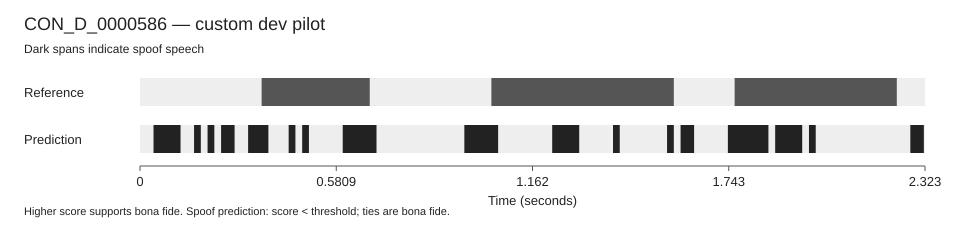
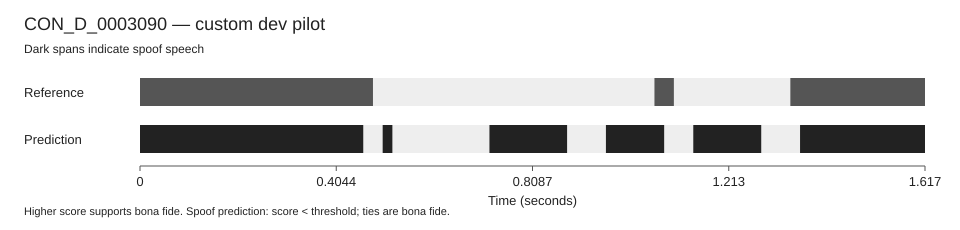
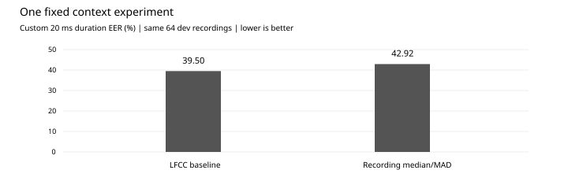

# First localization pilot

The first LFCC/logistic model completed on 10 October 2026, seed 45. It used
128 official train recordings and scored 64 fixed official dev recordings.
Each subset balances utterance classes; binary frame classes are different.
All 192 WAV files passed the real sample-count and native-label alignment
checks. No label vector was trimmed or padded. Eval was not used.

| Check | Result |
| --- | ---: |
| Training frames seen | 21,021 |
| Training frames retained | 9,048 (4,524 per binary class) |
| Solver iterations | 14, no warnings |
| Worker computation time | 1.28 s |
| Worker lifetime peak RAM | 136.7 MiB |
| Custom duration-weighted EER | 39.50% |
| Missed spoof duration at fixed zero threshold | 18.29 / 58.05 s |
| False alarm duration at fixed zero threshold | 84.20 / 175.09 s |

The small baseline makes many mistakes, especially false alarms. This gives
us a checked starting point for error analysis; it is not a useful authenticity
decision system. Runtime includes feature extraction, fitting, dev scoring
and writing outputs, but excludes imports, data preparation and alignment.
The supervised worker stage including startup took about three seconds.

The EER is our custom diagnostic on minimum-pooled 20 ms binary labels,
weighted by actual interval duration, including clipped terminal bins.
It selects the closest observed false-alarm/miss operating point on the same
dev subset, without interpolation. It is **not official SegmentEER or RangeEER**.
The displayed timelines instead use threshold zero, fixed before training.
Higher scores support bona fide audio; scores are not probabilities.

## Timelines

Ten dev IDs were fixed before scoring (five spoof and five bona fide
utterances). Dark reference spans represent native binary spoof labels,
including any nonspeech labelled spoof by the publisher. These are not VAD
speech-only annotations. Predictions are shown without smoothing.

All ten SVGs are in `docs/figures/localization_pilot_v1/`. Model and detailed
scores remain under the ignored job directory:
`outputs/jobs/localization-pilot-20261010T163921940Z/pilot/`.

## Next work

The reference search, range diagnostic and one preplanned context experiment
are complete. The public archives contain no publisher RTTM reference;
native-label-derived range results are explicitly reported as custom
diagnostics. See [reference and metric details](LOCALIZATION_METRICS.md).

| Diagnostic on the same 64 dev recordings | LFCC baseline | Recording median/MAD |
| --- | ---: | ---: |
| Custom pooled 20 ms duration EER | 39.50% | 42.92% |
| Derived native-10 ms reference RangeEER | 39.38% | 42.97% |
| Missed spoof at fixed zero threshold | 18.29 s | 20.40 s |
| False alarm at fixed zero threshold | 84.20 s | 87.76 s |

The single fixed transform subtracts the median of each feature dimension
within its own unlabelled recording and divides by max(1.4826 times MAD, 0.001).
All other model settings and IDs stay fixed. It made EER worse by 3.42
percentage points. There was no search for another floor, seed or threshold.
Both models remain saved. The first context attempt failed while updating
a Windows status file after fitting; a bounded I/O repair and a new frozen
attempt completed with the same model/transform. Failed logs are preserved.

The [error analysis](LOCALIZATION_ERRORS.md) found 1,349 predicted spoof runs
for 109 reference runs, including 989 predictions with no reference overlap.
The median predicted run is 60 ms. Speech also has many false alarms, so
dropping nonspeech would neither solve the errors nor preserve the same task.

The current conclusion is to retain the baseline and stop tuning this
simple normalization idea. A stronger acoustic representation needs a new
frozen experiment with a measured compute budget; it should be tested before
adding more complexity to the demo.
Do not tune repeatedly on this small dev subset and call it independent
validation. PartialSpoof shares source material with ASVspoof.

The [PDF and LaTeX report](report/README.md) now include localization,
timelines, the negative ablation and metric limitations. Evidence:
[frozen configuration and results](validation/localization_pilot_v1.json),
[real alignment audit](validation/localization_alignment.json),
[independent 16-check review](validation/localization_pilot_review_v1.json),
[context result](validation/localization_context_v1.json),
[independent context review](validation/localization_context_review_v1.json),
[range diagnostic](validation/localization_range_results_v1.json),
[training sequence](LOCALIZATION_TRAINING.md), [metric limitations](RANGE_EER_CONFORMANCE.md).
