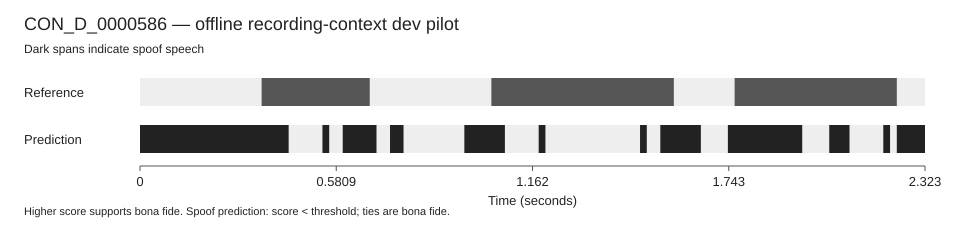
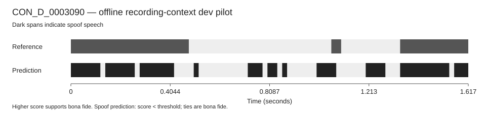

# Recording context: one negative result

The planned median/MAD recording-context ablation completed on 10 October
2026. It used the same fixed 128 train and 64 dev recordings, seed 45 and
classifier as the first localization pilot. No eval data was used.

| Custom dev diagnostic | Baseline LFCC | Recording context |
| --- | ---: | ---: |
| Duration-weighted 20 ms EER | 39.50% | 42.92% |
| Missed spoof seconds at threshold zero | 18.29 / 58.05 | 20.40 / 58.05 |
| False alarm seconds at threshold zero | 84.20 / 175.09 | 87.76 / 175.09 |
| Retained train frames | 9,048 | 9,048 |
| Solver iterations | 14 | 13 |

Context normalization made all three error diagnostics worse on this subset.
The EER increased by 3.42 percentage points. The original LFCC baseline
remains the better of these two small pilots, though neither is accurate
enough for a practical authenticity decision. This is a useful negative
result for the planned comparison; no additional parameter search was run.

The transform centers each of the 60 LFCC dimensions by its whole-recording
median and divides by `max(1.4826 * MAD, 0.001)`. This includes static, delta
and double-delta features. It uses unlabelled audio from the same recording,
including future bins, so it is explicitly offline. Train-only StandardScaler
and logistic regression then run exactly as before. The rule and all input
and source hashes were saved before fitting.

Both EER values are custom 20 ms min-pooled, clipped-duration diagnostics,
with a threshold sweep on this same dev subset. They are not official
SegmentEER or RangeEER. The fixed-zero duration errors and timelines are
separate from the EER threshold sweep. Scores are not probabilities.

The successful worker computation took 1.28 seconds; the supervised stage
including startup took 3.61 seconds. Its observed lifetime peak was 137.3 MiB.
There were no convergence warnings. An earlier attempt stopped after fitting
because a Windows reader briefly blocked atomic status-file replacement,
before any dev scores were saved. That attempt and its freeze are retained.
The only retry added bounded status-file I/O handling, with the same features,
model and data; it did not tune parameters based on scores.

Ten SVG timelines are saved in `docs/figures/localization_context_v1/`.
Evidence: [exact plan](../LOCALIZATION_CONTEXT_PLAN.md),
[initial freeze](../validation/localization_context_frozen.json),
[infrastructure retry freeze](../validation/localization_context_frozen_v2.json),
[configuration, results, hashes and comparison](../validation/localization_context_v1.json).
Raw scores and model stay in the ignored job directory recorded by that audit.
