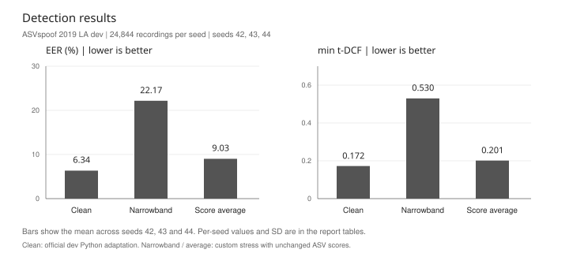
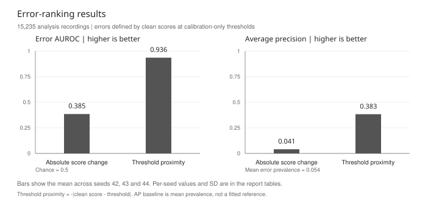
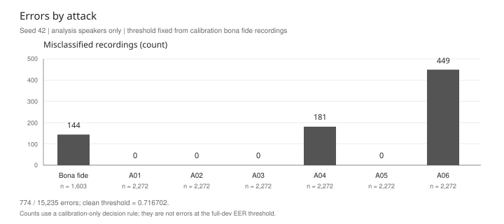
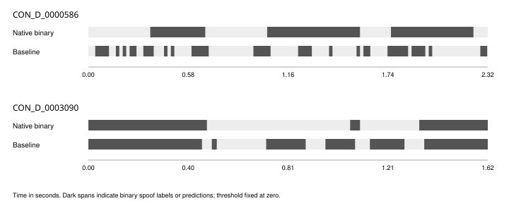
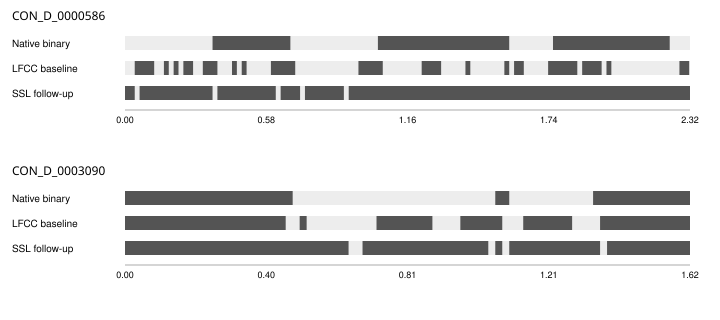

# Audio Deepfake Detection and Localization

Özgür Ekin Sönmez

Markdown edition of the [PDF report](docs/report/audio_deepfake_report.pdf). Both use the same report text, tables and figure generators.

## A small detector, and a test of its errors

AUDIO DEEPFAKE DETECTION / DEVELOPMENT REPORT

I tested whether a simple bandwidth change can reveal when a small speech detector is wrong. It did not work well in this experiment. The original score's distance from a fixed decision threshold was a much better error-ranking signal.

### What I built

This is an independent portfolio project using public ASVspoof 2019 Logical Access (LA) data [1, 2]. The first milestone is full-recording detection: one score for an entire recording. A separate small PartialSpoof localization pilot now adds scores for time ranges inside a recording; it is covered later in this report.

I chose LFCC features [3] and a Gaussian mixture model (GMM) [6] as a small, inspectable baseline. Running on a laptop CPU is an engineering choice; the research question concerns detection errors. I trained three fixed model seeds, then reused those models for a narrowband stress test. The useful result is a clear failure of the proposed diagnostic, with the data and checks needed to repeat it.

| Official split | Recordings | Bona fide | Spoof |
| --- | --- | --- | --- |
| Train | 25,380 | 2,580 | 22,800 |
| Development | 24,844 | 2,548 | 22,296 |

Only official keyed train/dev records are used. The 142 unkeyed dev archive members are excluded. Evaluation audio was not extracted, decoded or scored.

### Baseline in one pass

The reader requires finite, nonempty, mono 16 kHz audio. Features use a 20 ms window, 10 ms hop, 512-point FFT, 20 linear filters, 20 coefficients, pre-emphasis 0.97, and first- and second-order deltas: 60 dimensions per frame. There is no VAD, CMVN or implicit input resampling.

Each class has a 32-component diagonal-covariance GMM. All train recordings are visited; a fixed random-priority reservoir retains at most 50,000 frames per class. This is 100,000 retained frames in total, not every training frame. Seeds are 42, 43 and 44; all six fitted mixtures converged without warnings.

`score = mean over frames [log p(frame | bona fide) - log p(frame | spoof)]`

Larger scores support bona fide speech. This is a Python adaptation; feature parity with the official MATLAB baseline has not been established.

## The experiment and its boundaries

### One fixed transformation

For each dev recording, I resampled 16 kHz to 8 kHz and back to 16 kHz. The implementation uses scipy.signal.resample_poly [7] with a Kaiser window (beta 5), constant zero padding, float64 intermediate samples and float32 output trimmed to the original length. No gain, clipping, noise or codec is added. Original audio stays unchanged.

This is an approximate bandwidth stress test, not a telephone channel simulation. The clean and transformed versions are scored by the same saved model. I keep both scores, their fixed average, their signed difference and its absolute value.

`average = clean / 2 + narrow / 2;  delta = narrow - clean`

### Detection metrics

EER balances false rejection and false acceptance. Minimum normalized t-DCF is the challenge's ASV-oriented detection cost. Both are calculated using the hash-pinned official 2019 v1 Python evaluator and matching dev ASV scores [4, 5]. Lower is better. Diagnostic thresholds are selected using dev labels.

Original scores are official-dev adaptation results. Narrowband and average scores are custom diagnostics. The ASV reference is kept unchanged, so their t-DCF does not model a transformed channel for both systems.

### Calibration and error analysis

| Dev group | Speaker IDs | Recordings | Bona fide / spoof |
| --- | --- | --- | --- |
| Calibration | 8 | 9,609 | 945 / 8,664 |
| Analysis | 12 | 15,235 | 1,603 / 13,632 |

The CM manifest contains 20 distinct dev speaker IDs. A fixed hash ranking assigns eight IDs to calibration and twelve to analysis. Groups share no speakers or records and are disjoint from train. All six attacks occur in each group. The partition uses the IDs recorded in the CM key, including those attached to spoof recordings.

For each model I sort the 945 clean calibration bona fide scores and use zero-based index 47 as the threshold. A clean score at or above it is accepted as bona fide. Each threshold accepts 898/945 calibration bona fide recordings (95.03%). An analysis error means disagreement between this clean prediction and the label.

| Seed | Frozen threshold | Calibration accepted |
| --- | --- | --- |
| 42 | 0.7167018056 | 898 / 945 |
| 43 | 0.7260986567 | 898 / 945 |
| 44 | 0.7200403810 | 898 / 945 |

The protocol was frozen before full transformed scoring, after clean dev and pilot results were seen. This is not a blind test or independent validation.

## Detection under a bandwidth change

Bars show means only. Individual seeds and population standard deviation (ddof=0) are retained in the tables; SD is not a confidence interval. All conditions use the same 24,844 dev recordings.

| Seed | Original EER | Narrow EER | Average EER |
| --- | --- | --- | --- |
| 42 | 5.89% | 18.56% | 8.59% |
| 43 | 6.67% | 24.96% | 9.30% |
| 44 | 6.47% | 22.99% | 9.19% |
| Mean +/- SD | 6.34 +/- 0.33% | 22.17 +/- 2.68% | 9.03 +/- 0.31% |

| Seed | Original t-DCF | Narrow t-DCF | Average t-DCF |
| --- | --- | --- | --- |
| 42 | 0.1527 | 0.4700 | 0.1923 |
| 43 | 0.1794 | 0.5680 | 0.2112 |
| 44 | 0.1850 | 0.5515 | 0.2003 |
| Mean +/- SD | 0.1724 +/- 0.0141 | 0.5298 +/- 0.0428 | 0.2012 +/- 0.0078 |

Narrowband scoring increased mean EER from 6.34% to 22.17%. The fixed average reached 9.03%, also worse than the original score. Minimum t-DCF followed the same pattern: 0.1724 for original, 0.5298 for narrowband and 0.2012 for the average. I kept all three seeds; no run was replaced based on its result.

### What changed from the pilot?

The balanced pilot used 2,000 train and 1,000 dev recordings with seed 42. Its original EER was 8.8%; the fixed average gave 8.4%. That small apparent benefit did not carry over to the full experiment. Both experiments retained at most 50,000 frames per class, but training recordings, sampled frame contents, dev population, class balance and the number of seeds differ. This comparison does not isolate one cause.

The pilot is part of the full dev population. It is not an independent dataset, and the full experiment is not a new held-out benchmark.

## Can score change rank clean prediction errors?

I compared two fixed signals on the 15,235 analysis recordings: absolute clean-to-narrow score change, and negative absolute distance from the clean decision threshold. A larger signal ranks a recording as more likely to be an error. Neither signal was fitted to the analysis labels.

Higher is better. AUROC 0.5 is the no-ranking reference. Mean error prevalence is 5.41%; each seed has its own prevalence. Bars show means only; the table retains each seed.

| Seed / ranking | AUROC | Average precision | Error prevalence |
| --- | --- | --- | --- |
| 42 / Score change | 0.5036 | 0.0464 | 5.08% |
| 42 / Score margin | 0.9379 | 0.3695 | 5.08% |
| 43 / Score change | 0.3382 | 0.0382 | 5.54% |
| 43 / Score margin | 0.9369 | 0.3911 | 5.54% |
| 44 / Score change | 0.3134 | 0.0374 | 5.60% |
| 44 / Score margin | 0.9339 | 0.3894 | 5.60% |

Across seeds, absolute score change gave AUROC 0.385 and average precision 0.041. The margin baseline gave AUROC 0.936 and AP 0.383. Mean error prevalence was 5.41%.

In this setup, a large response to bandwidth change is not a useful warning that the original prediction is wrong. The simple margin is much more informative. I did not invert the change signal, search averaging weights or tune a new rejection threshold after seeing this result. This is error ranking, not calibrated probability or a validated abstention policy.

## What the errors look like

Seed 42, analysis speakers only, at its frozen calibration threshold. Bona fide errors are rejected genuine recordings; spoof errors are accepted spoof recordings. Each attack has 2,272 analysis recordings; bona fide has 1,603.

Seed 42 made 774 analysis errors: 144 bona fide rejections, 181 A04 acceptances and 449 A06 acceptances. There were no observed errors for A01, A02, A03 or A05 at this threshold. These counts use the calibration threshold, so they differ from the separate full-dev EER-threshold diagnostic.

### Three selected examples

| Recording ID | Attack | Signed change | Distance to threshold |
| --- | --- | --- | --- |
| LA_D_1012227 | A06 | -1.2318 | 0.3462 |
| LA_D_1402046 | A06 | +0.1553 | 0.0121 |
| LA_D_5369918 | A04 | -2.5769 | 0.9463 |

All three examples are spoof recordings accepted by the original model. LA_D_1402046 is close to the threshold but changes little after resampling. LA_D_5369918 changes much more, yet is farther from the threshold. These examples illustrate why transformation response and clean-score margin measure different things; they do not establish a causal explanation for the errors.

Examples follow the frozen deterministic rule: first ID in each delta-sign and top-quarter disagreement stratum, then fill to ten by descending absolute change and ID. The full audit saves ten examples per seed. This is an illustrative selection, not a random sample.

### What I would inspect next

A04 and A06 are useful starting points for listening and feature inspection. The current results do not show that the model detects new synthesis systems, real telephone recordings or partially manipulated clips. The local demo shows a raw score and measured latency. It cannot establish that a recording is authentic.

## Reproduction, limitations and next work

### What is saved

Configs, seeds, dataset version, official splits, frame-sampling rules, model and source hashes, paired scores, partitions, thresholds, package versions, metrics and failure examples are recorded. Public summaries stay in Git; downloaded audio, reference evaluator code, local score tables and models are ignored. Only public data was used.

Environment: Python 3.12.14; NumPy 2.5.3; SciPy 1.18.1; scikit-learn 1.9.1; Joblib 1.6.0; SoundFile 0.13.1. The local machine has about 16 GiB RAM and Intel Iris Xe graphics. The experiments use CPU inference and one numerical thread.

Two interruptions are preserved. The first clean run exposed a memory-probe bug; a scoring-only recovery reused its saved model. Later, narrowband seed 44 stopped when system available RAM fell below 1 GiB, with worker peak memory about 207 MiB. Recovery kept seeds 42/43, counted the failed attempt against the same seed budget and finished all remaining chunks. These runs are not an uninterrupted end-to-end timing benchmark.

### Limits of this result

All reported metrics are development diagnostics. Train/dev use the same attack taxonomy. Clean dev and pilot outcomes were already inspected; speaker separation inside dev does not remove that reuse. Three seeds measure variation on one population, not statistical independence or a significance test. The stress test changes only the countermeasure input. LFCC parity with the official MATLAB baseline has not been checked.

The project does not yet demonstrate unseen-generator generalization, calibrated confidence, real-world channel robustness, reliable partial manipulation localization or production deployment. A negative result here applies to this transformation, model and diagnostic, not to all transformation-based methods.

### Next milestone

The local scoring demo, timing study and first PartialSpoof localization pilot are complete. The later pages cover its alignment checks, first errors and one fixed context experiment. A stronger representation and genuinely external data would need a separate protocol and measured compute budget.

## Local demo and processing time

The demo loads the saved seed-43 detector and scores one WAV or FLAC recording. Seed 43 was fixed before timing, without choosing the best detector seed. The model hash, configuration, package versions and training metadata are checked before use.

### What the demo shows

The interface runs at http://127.0.0.1:8765. It shows a raw model score, audio duration and processing time. Higher scores support bona fide speech in this model; the value is not a probability. Uploads stay in memory. Inputs must be finite mono 16 kHz WAV/FLAC, at most 60 seconds and 8 MiB. The server listens only on the local computer.

### A small, fixed timing study

I selected the first 20 official development protocol rows in their original order before timing. After one explicit warm-up, I made three measured passes: 60 observations. All 60 scores matched the saved seed-43 clean scores exactly. Measurement covers validation, audio decoding, LFCC extraction and GMM scoring through the Python scoring function; browser and HTTP overhead are excluded.

| Measurement | Observed value |
| --- | --- |
| Mean per recording | 12.40 ms |
| Median (p50) | 11.64 ms |
| p95 | 16.92 ms |
| Total processing / audio duration | 0.00312 RTF |
| Model load and verification (separate) | 0.211 s |
| Process peak memory | 189 MiB |

Hardware: Intel Core i7-1195G7, four cores and eight logical threads; one numerical thread was used. The GPU was unused. A ratio of 0.00312 means the measured processing took about 0.31% of the combined audio duration. Model loading is outside the per-recording timer.

### Limits of this measurement

These 20 recordings happen to be bona fide speech from one speaker (LA_0069), lasting 2.555-5.927 seconds. Repeated measurements share the same model and warm operating-system file cache. They are dependent observations. This is a limited engineering check, not a claim about all audio, attack diversity, cold starts, streaming or production performance.

Evidence: docs/validation/demo_latency_plan.json and demo_latency.json. The plan was written before measurement and records selection, source/model hashes, resource limits and timing scope. No new training or large download was needed.

## Finding manipulated time ranges

The second part of this project asks where fake audio occurs inside a recording. I used PartialSpoof v1.2 [8, 9], keeping its official splits. This first pilot uses 128 train and 64 dev recordings, balanced by utterance class and selected with seed 45 before fitting. Eval stays closed. PartialSpoof shares source material with ASVspoof, so this is not independent cross-dataset validation.

### Checking the time labels

All 192 selected WAVs passed individual hash and header checks. Each native binary vector has exactly ceil(N/160) labels for N samples at 16 kHz. No label was trimmed or padded. VAD timestamps can end up to 15 samples early, and VAD nonspeech can carry either binary class. I kept the publisher's binary truth and used VAD only for diagnostics.

### A small temporal model

I mapped the existing 60-dimensional LFCC features to 20 ms output intervals using the nearest window centre, choosing the earlier frame on ties. Native 10 ms labels are minimum-pooled in adjacent pairs; a final interval is clipped to the actual recording length. The model is StandardScaler plus logistic regression [11] (C=1, lbfgs, maximum 300 iterations). This is a new small baseline, not a reproduction of the authors' neural model.

Normalization uses retained training frames only. The seed-45 reservoir is capped at 50,000 frames per binary class and balances to the smaller class. This pilot retained 4,524 frames per class and converged in 14 solver iterations without warnings. Output scores are uncalibrated and higher means bona fide. The classifier boundary zero was fixed for the displayed timelines.

| Pilot measurement | Observed value |
| --- | --- |
| Custom duration-weighted 20 ms EER | 39.50% |
| Missed spoof at threshold zero | 18.29 / 58.05 s |
| False alarm at threshold zero | 84.20 / 175.09 s |
| Computation / peak process RAM | 1.28 s / 136.7 MiB |

The EER is our closest-grid duration diagnostic on pooled 20 ms labels, without interpolation. It is not official 10 ms SegmentEER or RangeEER. The threshold sweep uses this same small dev set. Computation excludes imports and data preparation. Independent output review reproduced the metric, durations, IDs, hashes and ten saved timelines.

## What the first timelines show

Two of ten dev examples fixed before scoring. The top recording contains substantial spoof; the second includes binary-spoof nonspeech. Gray background means the remaining duration, not a confidence interval. Predictions use the fixed zero threshold, with no smoothing.

The first model makes many errors. At threshold zero, it marks a large part of bona fide duration as spoof and still misses real spoof ranges. The timelines are useful for inspecting those failures; they do not prove authenticity. Binary spoof reference spans include nonspeech where the publisher labelled it spoof.

### Limits of the pilot

There is one model seed and a deliberately small balanced utterance sample. Per-frame data are correlated within a recording, and there is no independent threshold test. The 20 ms output grid does not imply 20 ms acoustic context or streaming latency: LFCC windows and deltas use adjacent and future audio.

### Fragmented false alarms

At threshold zero, 109 pooled-reference spoof runs produce 1,349 prediction runs; 989 predictions have no reference overlap. The median predicted run lasts 60 ms. False alarms occur in speech as well as nonspeech. A VAD mask would change the reference target and would not solve the speech errors.

Evidence: docs/validation/localization_alignment.json; localization_pilot_v1.json; localization_pilot_review_v1.json; localization_errors_v1.json. Native and pooled reference resolutions are kept separate in the error analysis.

## One context change, and the reference limits

I tested one idea from the pilot plan: compare each frame with its own recording context. For every LFCC dimension, I subtracted the recording median and divided by max(1.4826 times MAD, 0.001). The full unlabelled recording supplies these statistics, including future audio. No dev labels enter the transform; train-only scaling and the classifier remain unchanged. This is offline and is not a new-method claim.

One seed and the same small dev subset. Bars use a zero-based axis; no confidence interval or generalization claim.

| Diagnostic | LFCC baseline | With context |
| --- | --- | --- |
| Custom 20 ms duration EER | 39.50% | 42.92% |
| Derived-reference RangeEER | 39.38% | 42.97% |
| Missed spoof at zero | 18.29 s | 20.40 s |
| False alarm at zero | 84.20 s | 87.76 s |

Context normalization made the custom EER worse by 3.42 percentage points and increased both fixed-zero error durations. I kept the negative result and did not search for another MAD floor, seed or threshold. The first attempt stopped on a Windows status-file sharing error; an infrastructure-only retry used the same model and transform. Both attempts and pre-fit freezes are retained.

### Why the range result is a diagnostic

The checked public train/dev archives contain no publisher RTTM reference. I converted the unchanged native 10 ms binary labels into contiguous spoof ranges and clipped the final interval to the actual WAV length. This is explicitly a derived reference; sub-bin boundaries and publisher silence treatment are unverified. I used the hash-pinned bounded patched upstream RangeEER [10] and pyannote.metrics [12], with separate dependencies and a 120-second external timeout. Independent duration arithmetic reproduced its selected operating point. It is not an unmodified official evaluator or paper reproduction.

Range scoring uses the upstream rule score <= threshold for spoof; project timelines use score < threshold. The range metric uses native 10 ms truth, while the earlier custom metric uses pooled 20 ms truth. References, source hashes, solver state and failure logs are saved in the audits. These results support keeping the original baseline for now; a stronger representation needs a separately planned experiment.

## A frozen encoder, with a separate convergence follow-up

I extracted pinned wav2vec2-base features [13] for the same 128 train and 64 dev recordings. Its 768-dimensional final states were aligned to the existing 20 ms output bins. All 192 caches, source/checkpoint hashes and resource receipts passed verification. T4 extraction took 18.27 seconds, with 1.394 GiB externally measured peak RAM. No encoder fine-tuning was performed.

### Preserving the failed experiment

The original SSL head used the same maximum 300 iterations as LFCC. It emitted a convergence warning and produced no accepted model or dev result. Its Windows monitor measured a launcher instead of the numerical child, so its reported RAM is invalid. I preserved that failure, repaired process supervision and tested the actual worker with a 64 MiB allocation.

Before any SSL dev scores, I recorded a separate train-only maximum of 3,000 iterations. C=1, lbfgs, tolerance 0.0001, seed 45, one thread, features and ordered training samples stayed fixed. The new fit converged in 303 iterations. External duration was 7.67 seconds and peak RAM 316.9 MiB. An independent no-fit replay checked retained feature bytes, scaler statistics, parameters and real worker PID before dev scoring.

| Same custom 64-dev diagnostic | LFCC max 300 | SSL max 3000 follow-up |
| --- | --- | --- |
| Pooled 20 ms duration EER | 39.50% | 28.57% |
| Derived native RangeEER | 39.38% | 28.75% |
| Missed spoof at zero | 18.29 s | 23.09 s |
| False alarm at zero | 84.20 s | 32.87 s |
| Predicted spoof runs | 1349 | 720 |

The custom duration EER decreased by 10.93 percentage points. At the fixed zero boundary, false-alarm duration decreased but missed spoof increased. This is a useful error trade-off, not evidence that every operating point improved. The SSL follow-up has a different optimization budget from LFCC 300; it is not an equal-training-budget comparison.

Evidence: docs/validation/localization_ssl_convergence_train_v1.json and localization_ssl_convergence_dev_v1.json. All 64 saved scores were reproduced exactly without fitting; a separate weighted ROC calculation reproduced EER. The original fixed 300 failure remains in localization_ssl_head_convergence_v2.json.

## SSL timelines and what the result cannot establish

The same two examples selected before scoring, with native reference, LFCC and SSL predictions. Dark spans indicate spoof. Both models use the fixed boundary zero; there is no smoothing or threshold selection for these tracks. Time is in seconds.

SSL still produces 720 predicted runs for 109 pooled-reference runs; 423 predictions have no reference overlap. Thirteen reference runs have no prediction overlap, and 46 are split across multiple predictions. These examples and aggregate counts show remaining localization errors despite the lower EER.

### Development evidence, not a benchmark claim

The same small dev subset has been inspected repeatedly. There is one model seed, no independent threshold test, and correlated frames within recordings. The whole-recording encoder uses future audio; a 20 ms score grid does not imply streaming latency. Encoder pretraining overlap is unknown, and PartialSpoof shares source material with ASVspoof.

The range diagnostic still uses derived native 10 ms reference ranges and the same bounded patched upstream evaluator. Publisher RTTM parity is unverified. Its score <= threshold rule differs from the displayed score < 0 rule. Evaluation data remains closed. No further solver, seed or threshold search was performed.

Next validation should use a separately fixed protocol and adequate independent data before making generalization or deployment claims. Public data only; no company data or internal results were used.

## References and acknowledgment

- [[1] ASVspoof 2019 LA v1. Public dataset, Zenodo record 6906306.](https://zenodo.org/records/6906306)
- [[2] Todisco et al. (2019). ASVspoof 2019: Future Horizons in Spoofed and Fake Audio Detection. Interspeech, 1008-1012.](https://www.isca-archive.org/interspeech_2019/todisco19_interspeech.html)
- [[3] Sahidullah, Kinnunen and Hanilci (2015). A comparison of features for synthetic speech detection. Interspeech, 2087-2091. Linked from the official baseline page.](https://www.asvspoof.org/index2019.html)
- [[4] ASVspoof 2019 Evaluation Plan, v0.4.](https://www.asvspoof.org/asvspoof2019/asvspoof2019_evaluation_plan.pdf)
- [[5] Official ASVspoof 2019 v1 Python evaluator. Pinned locally for EER and normalized t-DCF.](https://www.asvspoof.org/asvspoof2019/tDCF_python_v1.zip)
- [[6] scikit-learn documentation: GaussianMixture.](https://scikit-learn.org/stable/modules/generated/sklearn.mixture.GaussianMixture.html)
- [[7] SciPy documentation: scipy.signal.resample_poly.](https://docs.scipy.org/doc/scipy/reference/generated/scipy.signal.resample_poly.html)
- [[8] PartialSpoof v1.2 public data. Zenodo record 5766198.](https://zenodo.org/records/5766198)
- [[9] Zhang et al. The PartialSpoof Database and Countermeasures for the Detection of Short Fake Speech Segments Embedded in an Utterance.](https://arxiv.org/abs/2204.05177)
- [[10] Zhang et al. Range-Based Equal Error Rate for Spoof Localization. Interspeech 2023.](https://www.isca-archive.org/interspeech_2023/zhang23v_interspeech.html)
- [[11] scikit-learn documentation: LogisticRegression.](https://scikit-learn.org/stable/modules/generated/sklearn.linear_model.LogisticRegression.html)
- [[12] Bredin (2017). pyannote.metrics: A Toolkit for Reproducible Evaluation, Diagnostic, and Error Analysis of Speaker Diarization Systems.](https://pyannote.github.io/pyannote-metrics/)
- [[13] Meta AI. wav2vec2-base model card, pinned revision 0b5b8e868dd84f03fd87d01f9c4ff0f080fecfe8.](https://huggingface.co/facebook/wav2vec2-base/tree/0b5b8e868dd84f03fd87d01f9c4ff0f080fecfe8)

### Acknowledgment

I used an AI coding assistant for implementation support, debugging, tests and report editing. Parallel agents helped review code and result tables. Reported metrics were calculated from saved experiment outputs.

Repository evidence: docs/validation/full_robustness_results_v1.json; docs/FULL_ROBUSTNESS_PLAN.md; docs/REPORT_EVIDENCE.md; configs/full_seed42.toml (and seeds 43/44); scripts/build_report_figures.py; scripts/build_project_report.py. The report and figure manifests record input and output SHA-256 hashes.

Dataset: Zenodo-6906306-v1, ODC-By 1.0. The official evaluator has a separate CC BY-NC-SA 4.0 license and stays outside Git. Public data attribution and source/license checks are in docs/DATA_PROTOCOL.md and docs/METRICS.md.

PartialSpoof v1.2 has separate CC BY 4.0 attribution requirements; its ASVspoof source has ODC-By terms. See docs/PARTIALSPOOF_PROTOCOL.md. Localization audit sources and derived references are documented separately from official benchmark results.
